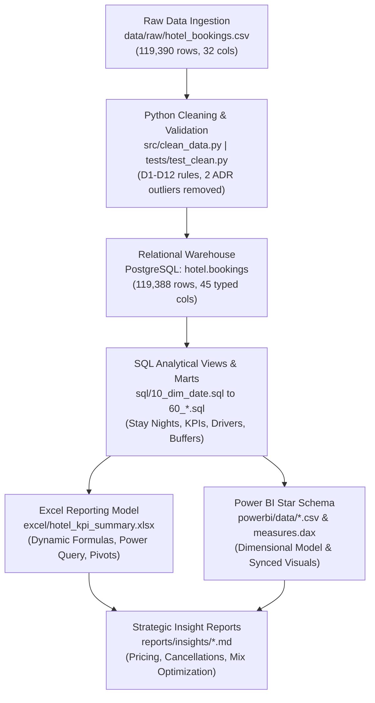

# Hotel Revenue & Cancellation Analytics

This end-to-end revenue analytics platform models booking pace, stay-night occupancy, cancellation dynamics, and distribution channel profitability for a dual-property hospitality group. Operating across 119,390 historical reservations from City Hotel (Lisbon) and Resort Hotel (Algarve) between July 1, 2015 and August 31, 2017, the pipeline cleans, structures, and transforms raw operational records into relational data marts, executive financial spreadsheets, and interactive BI dashboards. Across the reliable 762-day stay window, the portfolio generated $25,187,186.16 in room revenue across 248,261 room nights sold, while identifying that City Hotel experienced a substantially higher cancellation rate of 41.73% compared to 27.76% at Resort Hotel.

---

## 2. Business Questions Answered

- **Seasonality & Dynamic Pricing**: How do demand tiers (Peak, Shoulder, Low) and RevPAR vary across months, and where can dynamic rate floors and peak compression premiums capture unrealized yield?
- **Price-Occupancy Mismatches**: Which operational months suffer from high occupancy (>85%) but suppressed ADR, and which low-demand winter months require volume stimulation?
- **Cancellation Dynamics & Lead Times**: How does cancellation risk escalate as booking lead time lengthens, and what empirical thresholds warrant tiered deposit policies?
- **Deposit Policy & The Non-Refund Paradox**: Why do Non-Refundable reservations exhibit an unexpected 99.36% cancellation rate, and how are these bookings concentrated by segment and channel?
- **Cancellation Timing & Late Revenue Risk**: What share of cancellations occurs within 7 days of arrival, and what is the quantified room revenue at risk?
- **Capacity & Overbooking Buffers**: Given that physical room count is absent from the dataset, what conservative daily overbooking allowance protects revenue without excessive walk risk?
- **Operational Room-Type Mismatch**: How frequently do check-in room assignments deviate from reserved room categories, and how does this walk-risk signal fluctuate seasonally?
- **Commercial Channel & Segment Mix**: Which distribution channels and market segments drive high-margin direct revenue versus low-ADR, high-cancellation wholesale volume?

---

## 3. Pipeline Diagram



---

## 4. Dataset and Attribution

- **Dataset Name**: Hotel Booking Demand
- **Original Source & Citation**:  
  Nuno António, Ana de Almeida, and Luís Nunes (2019). *"Hotel booking demand datasets"*, **Data in Brief**, Volume 22, February 2019, pages 41–49. DOI: [10.1016/j.dib.2018.11.126](https://doi.org/10.1016/j.dib.2018.11.126).
- **Public Repository**: Hosted on Kaggle by Jesse Mostipak at [kaggle.com/datasets/jessemostipak/hotel-booking-demand](https://www.kaggle.com/datasets/jessemostipak/hotel-booking-demand).
- **Attribution Note**: The dataset contains real booking records from two Portuguese hotels: City Hotel (an urban hotel in Lisbon) and Resort Hotel (a coastal resort in the Algarve region), covering arrival dates from 2015-07-01 to 2017-08-31. All personal guest and corporate identifiers were deleted or sanitized prior to publication.

---

## 5. Assumptions and Decisions

- **Capacity Derivation (Rule W2)**: The dataset lacks physical room inventory. For each property, peak room capacity was empirically derived from the maximum rooms sold on any single night in the reliable window with a 10% safety buffer, rounded up to the nearest ten:
  - **City Hotel**: Peak observed rooms sold was 226 on 2016-08-13 $\rightarrow$ $226 \times 1.10 = 248.6 \rightarrow$ **250 rooms capacity**.
  - **Resort Hotel**: Peak observed rooms sold was 187 on 2016-03-25 $\rightarrow$ $187 \times 1.10 = 205.7 \rightarrow$ **210 rooms capacity**.
  - Stored in `config/assumptions.yml` and `hotel.capacity` as an explicit analytical assumption.
- **Reliable Stay Window (Rule W1)**: Stays that began before 2015-07-01 and arrivals after 2017-08-31 are missing from the dataset. Stay-night KPIs (occupancy, ADR, RevPAR) are restricted to stay dates **2015-08-01 to 2017-08-31** (**762 calendar days**). Booking-level pace metrics utilize all 119,388 arrivals.
- **Duplicate Rows (Decision D7)**: Exactly 31,994 rows (26.80% of the raw file) are identical across all 32 original columns. Because the raw data has no primary booking identifier, duplicates may represent real separate bookings (e.g. group rooms) or automated agent retries. In accordance with D7, all duplicate rows are retained and flagged (`is_duplicate_row = 1`). Sensitivity analyses in both notebook and SQL environments confirm core findings hold across deduplicated subsets.
- **ADR Outlier Exclusions (Decision D5)**: Exactly 2 rows were excluded from the analytical dataset: one negative rate (`adr = -$6.38`) and one extreme outlier (`adr = $5,400.00`). Excluded records are logged with written audit reasons in `data/processed/excluded_rows.csv`, leaving 119,388 valid bookings. Legitimate zero-ADR stays (1,959 rows, including 680 Complementary stays) were retained and generate zero room revenue per Rule K2.
- **Stay Conversion Proxy (Rule K6)**: Defined as Check-Out bookings divided by total bookings ($1 - \text{cancellation rate}$). Because the dataset lacks web traffic, impressions, or inquiry funnel logs, this metric represents reservation fulfillment rather than marketing funnel conversion.

---

## 6. KPI Definitions Table

| KPI Rule | Metric Name | Authoritative Formula & Business Definition | Aggregation & Usage Constraints |
| :--- | :--- | :--- | :--- |
| **K1** | **Room-Night Sold** | $\sum (\text{checkout\_date} - \text{arrival\_date})$ for all non-cancelled bookings (`is_canceled = 0`). Bookings with zero nights contribute 0 room-nights. | Attributed to each calendar night of stay within the stay interval. |
| **K2** | **Room Revenue** | $\sum (\text{adr} \times \text{stay\_nights})$ across room-nights sold. Cancelled bookings earn $0 (no deposit collection data exists). | Reported for stay dates within the reliable window (2015-08-01 to 2017-08-31). |
| **K3** | **Average Daily Rate (ADR)** | $\text{Room Revenue} / \text{Room-Nights Sold}$. | **Never** use `AVG(adr)` across raw booking rows; must be weighted by stay nights. |
| **K4** | **Occupancy % & RevPAR** | $\text{Occupancy \%} = \frac{\text{Room-Nights Sold}}{\text{Capacity} \times \text{Days}}$. $\text{RevPAR} = \frac{\text{Room Revenue}}{\text{Capacity} \times \text{Days}} \equiv \text{ADR} \times \text{Occupancy \%}$. | RevPAR identity is strictly validated across every reporting mart ($\text{RevPAR} = \text{ADR} \times \text{Occ}$). |
| **K5** | **Cancellation Rate** | $\frac{\text{Bookings with } is\_canceled = 1}{\text{Total Bookings}}$, attributed to the arrival month. | No-show rate (`is_no_show = 1`) is monitored and reported separately. |
| **K6** | **Stay Conversion (Proxy)** | $\frac{\text{Bookings with } reservation\_status = \text{'Check-Out'}}{\text{Total Bookings}} \equiv 1 - \text{Cancellation Rate}$. | Dataset has no web analytics; represents booking completion, not web funnel conversion. |
| **K7** | **Aggregation Boundaries** | Occupancy and RevPAR exist **only** at the hotel property level. Slices by segment or channel must use room-night share, revenue share, and ADR. | Prohibits synthetic segment-level occupancy; segment views must be labeled as contribution to hotel total. |

---

## 7. Method by Phase

- **Phase 1: Ingestion, Cleaning & Relational Loading**: Verified raw dataset integrity against 8 automated schema checks, generated deterministic row identifiers ([Decision D1](PROJECT_CONTEXT.md#L22)), derived locale-safe calendar dates ([Decision D2](PROJECT_CONTEXT.md#L23)), resolved missing values without silent record deletion ([Decision D3](PROJECT_CONTEXT.md#L24)), isolated 2 ADR outliers into [`data/processed/excluded_rows.csv`](data/processed/excluded_rows.csv) ([Decision D5](PROJECT_CONTEXT.md#L26)), and loaded 119,388 validated bookings into PostgreSQL (`hotel.bookings`) using transactional idempotency. Key files: [`src/clean_data.py`](src/clean_data.py), [`tests/test_clean.py`](tests/test_clean.py), [`sql/01_schema.sql`](sql/01_schema.sql), [`src/load_to_postgres.py`](src/load_to_postgres.py), [`src/check_phase1.py`](src/check_phase1.py).
- **Phase 2: Relational Modeling & Analytical SQL Marts**: Expanded non-cancelled bookings into 255,030 daily stay-night rows ([Rule K1](PROJECT_CONTEXT.md#L40)), implemented the 762-day reliable window and derived capacity models ([Rules W1, W2](PROJECT_CONTEXT.md#L49-L50)), and engineered 17 analytical SQL views covering monthly performance, booking pace, 12-dimension cancellation drivers, late cancellation revenue risk, seasonality tertiles, overbooking buffers, and channel/segment performance, validated via independent pandas re-computation. Key files: [`sql/20_stay_nights.sql`](sql/20_stay_nights.sql), [`sql/21_capacity_daily.sql`](sql/21_capacity_daily.sql), [`sql/30_monthly_kpis.sql`](sql/30_monthly_kpis.sql), [`sql/40_cancellation_drivers.sql`](sql/40_cancellation_drivers.sql), [`sql/50_segment_channel.sql`](sql/50_segment_channel.sql), [`sql/60_seasonality_overbooking.sql`](sql/60_seasonality_overbooking.sql), [`src/crosscheck_sql_vs_pandas.py`](src/crosscheck_sql_vs_pandas.py).
- **Phase 3: Spreadsheet Financial Modeling (Excel)**: Constructed an enterprise financial reporting model in [`excel/hotel_kpi_summary.xlsx`](excel/hotel_kpi_summary.xlsx) featuring 15 sheets, a 100% formula-driven executive dashboard across 399 audited cells with zero hardcoded numbers, multi-table slicer-connected PivotTables, automated reconciliation assertions in `Checks`, and pure Power Query M ingestion scripts parameterized by `DataFolder`. Key files: [`src/build_workbook.py`](src/build_workbook.py), [`excel/EXCEL_SPEC.md`](excel/EXCEL_SPEC.md), [`excel/PIVOT_BUILD_GUIDE.md`](excel/PIVOT_BUILD_GUIDE.md), [`excel/POWER_QUERY_GUIDE.md`](excel/POWER_QUERY_GUIDE.md), [`excel/power_query/`](excel/power_query/).
- **Phase 4: Business Intelligence & Star Schema Architecture (Power BI)**: Modeled a dimensional star schema constellation across 6 tables (48 columns) and 26 explicit DAX measures with zero bidirectional joins or calculated columns, applied an accessible WCAG-compliant custom color theme, provided click-by-click build instructions, and built a multi-scenario verification engine across S1–S6. Key files: [`sql/70_powerbi_model.sql`](sql/70_powerbi_model.sql), [`powerbi/MODEL_SPEC.md`](powerbi/MODEL_SPEC.md), [`powerbi/measures.dax`](powerbi/measures.dax), [`powerbi/REPORT_SPEC.md`](powerbi/REPORT_SPEC.md), [`powerbi/BUILD_GUIDE.md`](powerbi/BUILD_GUIDE.md), [`src/make_pbi_validation.py`](src/make_pbi_validation.py).
- **Phase 5: Inferential Statistics, Strategic Insights & Number Audit**: Executed 6 inferential statistical tests (two-proportion z-tests, chi-square tests, Mann-Whitney U, logistic regression), authored 3 strategic insight reports with mathematical scenarios on pricing, cancellations, and overbooking/mix, and achieved a 100% clean automated number and causal language audit verifying all 2,073 figures against disk data sources. Key files: [`notebooks/02_statistical_tests.ipynb`](notebooks/02_statistical_tests.ipynb), [`reports/insights/01_pricing_seasonality.md`](reports/insights/01_pricing_seasonality.md), [`reports/insights/02_cancellations.md`](reports/insights/02_cancellations.md), [`reports/insights/03_overbooking_mix.md`](reports/insights/03_overbooking_mix.md), [`src/audit_report_numbers.py`](src/audit_report_numbers.py).

---

## 8. Key Findings

- **Property Cancellation Divergence**: City Hotel displays a substantially higher cancellation rate of 41.73% (33,102 cancellations across 79,330 bookings) compared to Resort Hotel at 27.76% (11,121 cancellations across 40,058 bookings), an absolute risk difference of +13.96 percentage points confirmed by a two-proportion z-test ($z = 47.91, p < 0.001$, Cohen's $h = 0.295$) [`reports/findings_data.json`, `cancellations.overall`].
- **Lead Time Cancellation Escalation**: Cancellation probability escalates monotonically as booking lead time lengthens, rising from 9.63% (1,902 / 19,746) in the 0–7 day lead bucket to 57.01% (14,077 / 24,691) for reservations made 181+ days in advance ($\chi^2 = 11,940.73, p < 0.001$, Cramer's $V = 0.3162$) [`reports/findings_data.json`, `cancellations.lead_time.lead_buckets`].
- **The Non-Refund Paradox**: Non-refundable reservations exhibit a counter-intuitive 99.36% cancellation rate (14,493 cancellations across 14,586 bookings; Cramer's $V = 0.4815$), concentrated heavily in Portuguese wholesale travel agency blocks (97.18% PRT country origin, 62.88% Groups segment, 93.58% TA/TO distribution channel), indicating wholesale block option abandonment or PMS status logging artefacts rather than individual retail guest cancellations [`reports/findings_data.json`, `cancellations.deposit_type.non_refund_totals`].
- **Late Cancellation Revenue at Risk**: A total of 5,135 cancellations occur within 7 days of arrival (11.61% of all cancellations, representing 14,841 room nights), generating an upper-bound potential revenue at risk of $1,533,486.66 (76.11% concentrated at City Hotel: $1,167,162.59) [`reports/findings_data.json`, `cancellations.timing_and_late_cancellations.late_cancellations_7d_summary`].
- **Commercial Mix & Channel Optimization**: Across both hotels, the Online TA segment generates the largest revenue share (53.2%, $13,395,128.51 at $114.78 ADR), whereas the Direct channel yields the highest ADR ($124.06) and lowest cancellation rate (15.3%), demonstrating that shifting 2,000 room nights per hotel from wholesale Groups to Direct delivers a net revenue expansion of +$189,200.00 (Scenario C1) [`reports/findings_data.json`, `overbooking_and_mix.segment_performance.All`].

---

## 9. Dashboard Screenshots

### Power BI Report Views
- **Page 1: Executive KPIs**:  
  
- **Page 2: Booking & Cancellations**:  
  
- **Page 3: Revenue & Segments**:  
  
- **Page 4: Strategic Insights**:  
  

### Excel Financial Workbook Views
- **KPI Summary Sheet**:  
  
- **Multi-Table Pivot Dashboard**:  
  

---

## 10. How to Reproduce

### Prerequisites
- **Python**: Version 3.10 or higher
- **PostgreSQL**: Version 14 or higher running locally
- **Git** & **Pip**
- **Microsoft Excel** (optional, to view `.xlsx`) and **Power BI Desktop** (optional, to open `.pbix`)

### Step-by-Step Reproduction Commands

```bash
# -------------------------------------------------------------
# 1. Environment & Database Configuration
# -------------------------------------------------------------
git clone <repo-url> hotel-revenue-analytics
cd hotel-revenue-analytics
python3 -m venv .venv
source .venv/bin/activate
pip install -r requirements.txt

# Configure PostgreSQL connection in .env (see .env.example)
# Requires PGHOST, PGPORT, PGUSER, PGPASSWORD, PGDATABASE=hotel_analytics
cp .env.example .env

# -------------------------------------------------------------
# 2. Phase 1: Ingestion, Cleaning, and Relational Load
# -------------------------------------------------------------
python src/verify_raw.py
python src/profile_raw.py
python src/clean_data.py
pytest tests/test_clean.py -v
jupyter nbconvert --to notebook --execute --inplace notebooks/01_cleaning_eda.ipynb
python src/create_database.py
python src/run_sql.py sql/01_schema.sql
python src/load_to_postgres.py
python src/run_sql.py sql/02_phase1_checks.sql
python src/check_phase1.py

# -------------------------------------------------------------
# 3. Phase 2: Stay Nights, Capacity, and Analytical SQL Marts
# -------------------------------------------------------------
python src/run_sql.py sql/10_dim_date.sql
python src/run_sql.py sql/20_stay_nights.sql
python src/run_sql.py sql/21_capacity_daily.sql
python src/write_assumptions.py
python src/run_sql.py sql/30_monthly_kpis.sql
python src/run_sql.py sql/31_booking_trends.sql
python src/run_sql.py sql/40_cancellation_drivers.sql
python src/run_sql.py sql/41_cancel_timing.sql
python src/run_sql.py sql/50_segment_channel.sql
python src/run_sql.py sql/60_seasonality_overbooking.sql
python src/run_sql.py sql/99_phase2_summary.sql
python src/export_sql_outputs.py
python src/crosscheck_sql_vs_pandas.py

# -------------------------------------------------------------
# 4. Phase 3: Excel Financial Workbook & Power Query Scripts
# -------------------------------------------------------------
python src/export_excel_inputs.py
python src/build_country_lookup.py
python src/build_workbook.py
python src/make_pivot_expected.py
python src/make_pq_scripts.py
python src/test_pq_scripts.py

# -------------------------------------------------------------
# 5. Phase 4: Power BI Star Schema, DAX, Theme & Validation
# -------------------------------------------------------------
python src/run_sql.py sql/70_powerbi_model.sql
python src/export_powerbi_model.py
python src/validate_powerbi_model.py
python src/make_pbi_m_scripts.py
python powerbi/power_query/test_m_scripts.py
python src/check_dax_refs.py
python src/validate_powerbi_theme.py
python src/make_dashboard_text.py
python src/make_pbi_validation.py

# -------------------------------------------------------------
# 6. Phase 5: Statistical Inference, Insights & Numbers Audit
# -------------------------------------------------------------
jupyter nbconvert --to notebook --execute --inplace notebooks/02_statistical_tests.ipynb
python src/make_findings_data.py
python src/validate_insights.py
python src/audit_report_numbers.py
```

---

## 11. Limitations and Next Steps

### Analytical Limitations
- **No Inbound Marketing Funnel**: The dataset records created bookings, meaning stay conversion ($1 - \text{cancellation rate}$) reflects post-booking fulfillment rather than web funnel demand conversion.
- **Derived Capacity Proxy**: Property capacities (250 rooms City, 210 rooms Resort) are calculated from observed maximum rooms sold with a 10% buffer rather than physical floor plan architectural blueprints.
- **Absence of Realized Cost Accounting**: The records contain no guest relocation/walk expenses, merchant processing fees, or actual cash deposit receipts, meaning financial impacts represent upper-bound operational scenarios.
- **Observational Data Structure**: Analysis reflects observational correlations; without randomized controlled trials, findings indicate association rather than direct causality.

### Planned Next Steps
- **Dynamic Pricing Engine**: Train machine learning pricing algorithms that ingest competitor rate scraping feeds and historical price elasticity.
- **Automated PMS Webhook Pipeline**: Implement streaming ingestion for new reservation events and real-time cancellation alerts.
- **A/B Testing Policy Pilot**: Design a controlled pilot testing non-refundable deposit terms and reconfirmation notifications on bookings with lead times exceeding 90 days.

---

## 12. Repository Structure

```
hotel-revenue-analytics/
├── config/
│   └── assumptions.yml
├── data/
│   ├── outputs/
│   │   ├── capacity.csv
│   │   ├── daily_performance.csv
│   │   ├── v_booking_trends.csv
│   │   ├── v_cancellation_drivers.csv
│   │   ├── v_monthly_kpis.csv
│   │   ├── v_overbooking_buffer.csv
│   │   └── v_segment_performance.csv
│   ├── processed/
│   │   ├── bookings_clean.csv
│   │   └── excluded_rows.csv
│   └── raw/
│       └── hotel_bookings.csv
├── docs/
│   ├── data_dictionary.md
│   ├── data_quality_log.md
│   ├── decision_log.md
│   ├── phase1_signoff.md
│   ├── phase2_signoff.md
│   └── phase4_signoff.md
├── excel/
│   ├── EXCEL_SPEC.md
│   ├── PIVOT_BUILD_GUIDE.md
│   ├── POWER_QUERY_GUIDE.md
│   ├── hotel_kpi_summary.xlsx
│   ├── inputs/
│   ├── power_query/
│   └── screenshots/
├── notebooks/
│   ├── 01_cleaning_eda.ipynb
│   └── 02_statistical_tests.ipynb
├── powerbi/
│   ├── BUILD_GUIDE.md
│   ├── DASHBOARD_TEXT.md
│   ├── MODEL_SPEC.md
│   ├── REPORT_SPEC.md
│   ├── VALIDATION_CHECKLIST.md
│   ├── data/
│   ├── measures.dax
│   ├── power_query/
│   ├── screenshots/
│   └── theme/
├── reports/
│   ├── audit_allowlist.txt
│   ├── figures/
│   ├── findings_data.json
│   ├── insights/
│   │   ├── 01_pricing_seasonality.md
│   │   ├── 02_cancellations.md
│   │   └── 03_overbooking_mix.md
│   └── tables/
│       ├── number_audit.csv
│       └── stat_tests_summary.csv
├── sql/
│   ├── 01_schema.sql
│   ├── 10_dim_date.sql
│   ├── 20_stay_nights.sql
│   ├── 21_capacity_daily.sql
│   ├── 30_monthly_kpis.sql
│   ├── 40_cancellation_drivers.sql
│   ├── 50_segment_channel.sql
│   ├── 60_seasonality_overbooking.sql
│   └── 70_powerbi_model.sql
├── src/
│   ├── audit_report_numbers.py
│   ├── build_workbook.py
│   ├── clean_data.py
│   ├── crosscheck_sql_vs_pandas.py
│   ├── load_to_postgres.py
│   ├── make_findings_data.py
│   ├── make_pbi_validation.py
│   └── validate_insights.py
└── tests/
    └── test_clean.py
```

---

## Screenshot Asset Checklist (Pending Capture)

The following dashboard and report screenshot assets are queued for manual desktop capture:
- [ ] `powerbi/screenshots/pbi_p1_executive_kpis.png`
- [ ] `powerbi/screenshots/pbi_p2_booking_cancellations.png`
- [ ] `powerbi/screenshots/pbi_p3_revenue_segments.png`
- [ ] `powerbi/screenshots/pbi_p4_strategic_insights.png`
- [ ] `excel/screenshots/excel_kpi_summary.png`
- [ ] `excel/screenshots/excel_pivots.png`
