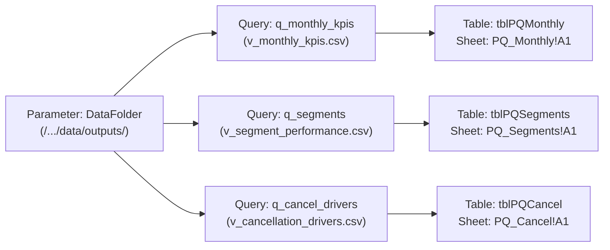

# Step-by-Step Manual Power Query Connection & Ingestion Guide

- **Target Workbook**: `excel/hotel_kpi_summary.xlsx`
- **Source Data**: Exported CSV Data Marts in `data/outputs/*.csv`
- **Target Sheets & Cells**:
  - `PQ_Monthly` at Cell `A1` (Excel Table: `tblPQMonthly`)
  - `PQ_Segments` at Cell `A1` (Excel Table: `tblPQSegments`)
  - `PQ_Cancel` at Cell `A1` (Excel Table: `tblPQCancel`)
- **Pre-generated M Scripts**: Located in `excel/power_query/`
- **Integrity Validation**: Statically checked via `src/test_pq_scripts.py`

---

> [!IMPORTANT]
> **Validation Notice**: The M code scripts have been validated for structural syntax, balanced delimiters (`()`, `[]`, `{}`), and exact column alignment against the live CSV headers using `src/test_pq_scripts.py`. Because Power Query evaluates M code inside Microsoft Excel's desktop engine, if Excel shows an error during load or refresh, **paste the exact error message back** for diagnosis.

---

## 1. Architectural Overview & Parameter Strategy

Instead of hardcoding brittle absolute file paths in individual queries, this workbook implements a centralized **Power Query Parameter** named `DataFolder`.



### Key Advantages:
1. **Frictionless Portability**: Moving the project folder or switching operating systems (macOS $\leftrightarrow$ Windows) requires updating only a single parameter value.
2. **Explicit Type Contract**: Every column is cast explicitly with the `"en-US"` locale culture, eliminating regional date/decimal misinterpretations.
3. **Zero Schema Drift**: M code column names are locked to the authoritative headers exported by `src/export_sql_outputs.py`.

---

## 2. Step 1: Create the `DataFolder` Parameter

1. Open `excel/hotel_kpi_summary.xlsx` in Microsoft Excel Desktop.
2. On the Excel Ribbon, go to **Data > Get Data > Launch Power Query Editor** (or press `Alt + A + P + T`).
3. In the Power Query Editor Ribbon, go to **Home > Manage Parameters > New Parameter** (click the drop-down below *Manage Parameters* and choose **New Parameter**).
4. In the *Manage Parameters* dialog box, enter the following settings:
   - **Name**: `DataFolder` *(Warning: M is case-sensitive; type exactly as shown)*
   - **Description**: `Full path to the hotel-revenue-analytics/data/outputs/ folder with trailing separator`
   - **Required**: Check the box (`[x] Required`)
   - **Type**: Select **Text**
   - **Suggested Values**: Select **Any value**
   - **Current Value**: Paste the absolute path to your repository's `data/outputs/` directory **ending with a trailing slash**.
     - **macOS / Linux Example**: `/Users/divyansh/code/Development/DataScience/hotel-revenue-analytics/data/outputs/`
     - **Windows Example**: `C:\Users\username\code\hotel-revenue-analytics\data\outputs\`
5. Click **OK**.
6. In the left *Queries* pane, `DataFolder` will appear with an `ABC` parameter icon.

---

## 3. Step 2: Create Query 1 — `q_monthly_kpis`

1. In the Power Query Editor Ribbon, select **Home > New Source > Other Sources > Blank Query**.
2. A new entry named `Query1` appears in the *Queries* pane.
3. On the Ribbon, click **Advanced Editor** (located on **Home** or **View** tab).
4. In the Advanced Editor window, select all existing text and delete it.
5. Open [`excel/power_query/q_monthly_kpis.m`](file:///Users/divyansh/code/Development/DataScience/hotel-revenue-analytics/excel/power_query/q_monthly_kpis.m), copy its entire content, and paste it into the editor:

```powerquery
let
    Source = Csv.Document(File.Contents(DataFolder & "v_monthly_kpis.csv"), [Delimiter=",", Encoding=65001, QuoteStyle=QuoteStyle.Csv]),
    #"Promoted Headers" = Table.PromoteHeaders(Source, [PromoteAllScalars=true]),
    #"Changed Type" = Table.TransformColumnTypes(#"Promoted Headers", {
        {"hotel", type text},
        {"month_start", type date},
        {"room_nights_sold", Int64.Type},
        {"room_nights_available", Int64.Type},
        {"room_revenue", type number},
        {"occupancy_pct", type number},
        {"adr", type number},
        {"revpar", type number}
    }, "en-US"),
    #"Inserted Year" = Table.AddColumn(#"Changed Type", "Year", each Date.Year([month_start]), Int64.Type),
    #"Inserted Month Name" = Table.AddColumn(#"Inserted Year", "Month_Name", each Date.MonthName([month_start]), type text),
    #"Added High Occupancy" = Table.AddColumn(#"Inserted Month Name", "High_Occupancy_Flag", each if [occupancy_pct] >= 85 then "High" else "Normal", type text),
    #"Sorted Rows" = Table.Sort(#"Added High Occupancy", {{"hotel", Order.Ascending}, {"month_start", Order.Ascending}})
in
    #"Sorted Rows"
```

6. Confirm the bottom of the window shows: *"No syntax errors have been detected."* Click **Done**.
7. In the **Query Settings** pane on the right:
   - Under **PROPERTIES**, change **Name** to: `q_monthly_kpis`.
8. Verify the data preview displays columns: `hotel`, `month_start`, `room_nights_sold`, `room_nights_available`, `room_revenue`, `occupancy_pct`, `adr`, `revpar`, `Year`, `Month_Name`, `High_Occupancy_Flag`.

---

## 4. Step 3: Create Query 2 — `q_segments`

1. In the Power Query Editor, go to **Home > New Source > Other Sources > Blank Query**.
2. On the Ribbon, click **Advanced Editor**.
3. Clear all text and paste the exact contents of [`excel/power_query/q_segments.m`](file:///Users/divyansh/code/Development/DataScience/hotel-revenue-analytics/excel/power_query/q_segments.m):

```powerquery
let
    Source = Csv.Document(File.Contents(DataFolder & "v_segment_performance.csv"), [Delimiter=",", Encoding=65001, QuoteStyle=QuoteStyle.Csv]),
    #"Promoted Headers" = Table.PromoteHeaders(Source, [PromoteAllScalars=true]),
    #"Changed Type" = Table.TransformColumnTypes(#"Promoted Headers", {
        {"hotel", type text},
        {"market_segment", type text},
        {"bookings", Int64.Type},
        {"cancellations", Int64.Type},
        {"cancel_rate_pct", type number},
        {"room_nights_sold", Int64.Type},
        {"room_revenue", type number},
        {"adr", type number},
        {"room_night_share_pct", type number},
        {"revenue_share_pct", type number},
        {"revenue_rank", Int64.Type},
        {"is_zero_revenue_segment", Int64.Type},
        {"is_underperformer", Int64.Type}
    }, "en-US"),
    #"Filtered Zero Revenue" = Table.SelectRows(#"Changed Type", each ([is_zero_revenue_segment] <> 1)),
    #"Added Performance Label" = Table.AddColumn(#"Filtered Zero Revenue", "Performance_Label", each if [is_underperformer] = 1 then "Underperformer" else "OK", type text),
    #"Removed Other Columns" = Table.SelectColumns(#"Added Performance Label", {"hotel", "market_segment", "bookings", "cancel_rate_pct", "adr", "revenue_share_pct", "revenue_rank", "Performance_Label"}),
    #"Sorted Rows" = Table.Sort(#"Removed Other Columns", {{"hotel", Order.Ascending}, {"revenue_rank", Order.Ascending}})
in
    #"Sorted Rows"
```

4. Confirm syntax shows no errors and click **Done**.
5. In **Query Settings**, change **Name** to: `q_segments`.
6. Verify the preview has filtered out zero-revenue rows (e.g. `Undefined`), added `Performance_Label`, and retained only the 8 specified columns.

---

## 5. Step 4: Create Query 3 — `q_cancel_drivers`

1. In the Power Query Editor, go to **Home > New Source > Other Sources > Blank Query**.
2. Click **Advanced Editor**.
3. Clear all text and paste the exact contents of [`excel/power_query/q_cancel_drivers.m`](file:///Users/divyansh/code/Development/DataScience/hotel-revenue-analytics/excel/power_query/q_cancel_drivers.m):

```powerquery
let
    Source = Csv.Document(File.Contents(DataFolder & "v_cancellation_drivers.csv"), [Delimiter=",", Encoding=65001, QuoteStyle=QuoteStyle.Csv]),
    #"Promoted Headers" = Table.PromoteHeaders(Source, [PromoteAllScalars=true]),
    #"Changed Type" = Table.TransformColumnTypes(#"Promoted Headers", {
        {"hotel", type text},
        {"dimension", type text},
        {"category", type text},
        {"sort_order", Int64.Type},
        {"bookings", Int64.Type},
        {"cancellations", Int64.Type},
        {"no_shows", Int64.Type},
        {"cancel_rate_pct", type number},
        {"share_of_bookings_pct", type number},
        {"cancel_rate_vs_hotel_avg_pp", type number}
    }, "en-US"),
    #"Filtered Rows" = Table.SelectRows(#"Changed Type", each ([hotel] = "All") and List.Contains({"lead_bucket", "deposit_type", "customer_type", "market_segment"}, [dimension])),
    #"Added Risk Level" = Table.AddColumn(#"Filtered Rows", "Risk_Level", each if [cancel_rate_vs_hotel_avg_pp] > 10 then "High" else if [cancel_rate_vs_hotel_avg_pp] > 0 then "Medium" else "Low", type text),
    #"Sorted Rows" = Table.Sort(#"Added Risk Level", {{"dimension", Order.Ascending}, {"sort_order", Order.Ascending}, {"cancel_rate_pct", Order.Descending}})
in
    #"Sorted Rows"
```

4. Confirm syntax shows no errors and click **Done**.
5. In **Query Settings**, change **Name** to: `q_cancel_drivers`.
6. Verify preview shows `hotel = "All"` filtered across the four designated dimensions, with derived `Risk_Level` and ordered categories.

---

## 6. Step 5: Close & Load To Dedicated Staging Sheets

To load each query into its exact pre-formatted worksheet placeholder cell `A1`:

### 6.1 Set Initial Load Mode
1. In the Power Query Editor Ribbon, click the small drop-down arrow under **Close & Load** (top left).
2. Select **Close & Load To...**
3. In the *Import Data* dialog:
   - Select **Only Create Connection**.
   - Click **OK**.
   *(This safely creates background connections without creating unwanted default sheets).*

### 6.2 Load Table 1: `tblPQMonthly` on Sheet `PQ_Monthly`
1. In the Excel main window, if the *Queries & Connections* side pane is not open, go to **Data > Queries & Connections**.
2. In the *Queries & Connections* pane, right-click **`q_monthly_kpis`** > choose **Load To...**
3. In the *Import Data* dialog:
   - Select **Table**.
   - Under *Where do you want to put the data?*, select **Existing worksheet**.
   - Click the sheet tab **`PQ_Monthly`** and select cell **`A1`** (the box should read `=PQ_Monthly!$A$1`).
   - Click **OK**.
4. With any cell inside the newly loaded table selected, go to the Ribbon tab **Table Design**:
   - In the far-left **Table Name** box, rename the table to **`tblPQMonthly`**.

### 6.3 Load Table 2: `tblPQSegments` on Sheet `PQ_Segments`
1. In the *Queries & Connections* pane, right-click **`q_segments`** > choose **Load To...**
2. In the *Import Data* dialog:
   - Select **Table**.
   - Select **Existing worksheet**: navigate to sheet **`PQ_Segments`** and click cell **`A1`** (`=PQ_Segments!$A$1`).
   - Click **OK**.
3. In **Table Design**, rename the table to **`tblPQSegments`**.

### 6.4 Load Table 3: `tblPQCancel` on Sheet `PQ_Cancel`
1. In the *Queries & Connections* pane, right-click **`q_cancel_drivers`** > choose **Load To...**
2. In the *Import Data* dialog:
   - Select **Table**.
   - Select **Existing worksheet**: navigate to sheet **`PQ_Cancel`** and click cell **`A1`** (`=PQ_Cancel!$A$1`).
   - Click **OK**.
3. In **Table Design**, rename the table to **`tblPQCancel`**.

---

## 7. How to Refresh Data

When underlying data marts in `data/outputs/*.csv` are re-exported or updated:

- **Full Workbook Refresh**:
  - On the Excel Ribbon, go to **Data > Refresh All** (or press `Ctrl + Alt + F5`).
  - This refreshes all 3 Power Query tables simultaneously along with the shared PivotTable cache.
- **Single Query Refresh**:
  - Right-click anywhere inside a staging table > select **Refresh**, or right-click the query name in *Queries & Connections* > **Refresh**.

---

## 8. Comprehensive Troubleshooting Guide

| Issue / Error Message | Root Cause | Exact Resolution |
| :--- | :--- | :--- |
| **`[DataSource.Error] Could not find a part of the path...`** or **`File not found`** | The `DataFolder` parameter value is incorrect, points to an invalid directory, or is missing the trailing slash (`/` on Mac, `\` on Windows). | 1. In Excel, go to **Data > Get Data > Launch Power Query Editor**.<br>2. Click `DataFolder` in the query list.<br>3. Verify the path exists and ends with `/` (e.g. `/.../data/outputs/`).<br>4. Run `python src/export_sql_outputs.py` from repo root to ensure CSVs are present. |
| **`[DataFormat.Error] We couldn't parse the input provided as a Date value`** | Operating system or Excel regional locale mismatch (e.g. European dates expecting `DD/MM/YYYY` vs ISO `YYYY-MM-DD`). | The generated M code already includes `, "en-US"` in `Table.TransformColumnTypes`. If this error occurs, verify that line 13 of `q_monthly_kpis.m` includes `, "en-US"` as the third parameter. |
| **`[DataFormat.Error]` on numeric conversion** | Unexpected non-numeric tokens, thousands separators, or commas used as decimal marks. | Re-export clean database outputs using `python src/export_sql_outputs.py`. The exporter enforces standard dot decimal notation and NULL integer representations. |
| **`[Expression.Error] The column '<column>' of the table wasn't found`** | Column name mismatch between CSV file and M code script. Note that Power Query M is **strictly case-sensitive** (`hotel` $\neq$ `Hotel`). | Run `python src/test_pq_scripts.py` from the repo root to verify that all column references match the CSV header row exactly. Re-run `python src/make_pq_scripts.py` if CSV headers changed. |
| **`[Formula.Firewall] Query references other queries or steps, so it may not access a data source directly`** | Excel's Data Privacy Firewall blocks combining local file access with a parameter query across privacy partitions. | In Excel: go to **File > Options and settings > Query Options > Current Workbook > Privacy** > select **Ignore the Privacy levels and potentially improve performance** > click **OK** > **Refresh All**. |

---

## 9. Structural Validation Audit Summary

Run the automated test suite anytime to re-verify script integrity:

```bash
./.venv/bin/python src/test_pq_scripts.py
```

Expected verification output:
```text
================================================================================
TESTING POWER QUERY M SCRIPTS FOR STRUCTURAL AND SCHEMA INTEGRITY
================================================================================

[PASS] Query: q_monthly_kpis.m (Source: v_monthly_kpis.csv)
   - Delimiters:   PASS -> All delimiters balanced () [] {} ""
   - Column Types: PASS -> All 8 CSV headers explicitly typed
   - Column Refs:  PASS -> All 3 referenced columns valid (3 from CSV, 0 derived)

[PASS] Query: q_segments.m (Source: v_segment_performance.csv)
   - Delimiters:   PASS -> All delimiters balanced () [] {} ""
   - Column Types: PASS -> All 13 CSV headers explicitly typed
   - Column Refs:  PASS -> All 10 referenced columns valid (9 from CSV, 1 derived)

[PASS] Query: q_cancel_drivers.m (Source: v_cancellation_drivers.csv)
   - Delimiters:   PASS -> All delimiters balanced () [] {} ""
   - Column Types: PASS -> All 10 CSV headers explicitly typed
   - Column Refs:  PASS -> All 5 referenced columns valid (5 from CSV, 0 derived)

================================================================================
[SUCCESS] ALL POWER QUERY SCRIPTS PASSED ALL INTEGRITY CHECKS.
================================================================================
```
