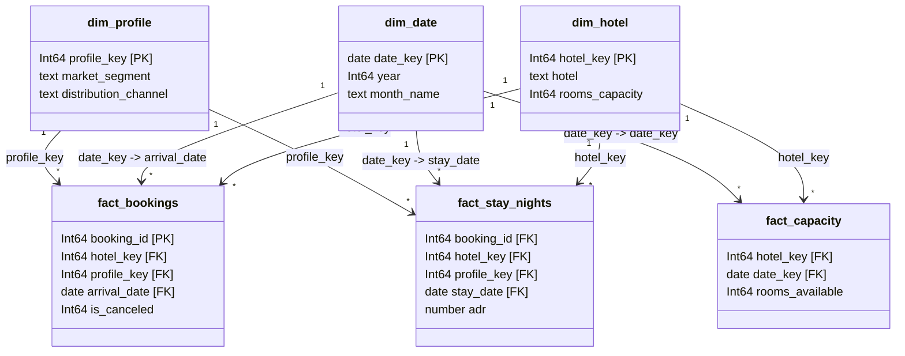

# Power BI Star Schema Data Model Specification

> [!IMPORTANT]
> **Source Fidelity**: All column names in this specification are taken directly from the physical CSV headers in `powerbi/data/*.csv`. Do not rename, add, or alter columns during ingestion. All calculations, ratios, and performance indicators belong strictly in **explicit DAX measures**.

---

## 1. Tables and Column Metadata

This data model follows a strict **Constellation / Star Schema** design centered around three fact tables (`fact_bookings`, `fact_stay_nights`, `fact_capacity`) and three shared dimension tables (`dim_date`, `dim_hotel`, `dim_profile`).

In accordance with enterprise Power BI modeling standards:
- **Default Summarization**: Set to **"Don't summarize"** for every column across all tables. This prevents users from accidentally creating implicit measures (such as `SUM(adr)` or `SUM(hotel_key)`).
- **Hidden in Report View**: All surrogate keys, foreign keys, private date keys on fact tables, and technical sort-order columns must be hidden from the Report view. Only user-facing attributes and explicit measures should be visible to report authors.

---

### 1.1 `dim_date` (Calendar Dimension)
- **Source**: `powerbi/data/dim_date.csv` (1,096 rows, covering 2015-01-01 to 2017-12-31)
- **Role**: Shared calendar dimension filtering arrivals, stays, and daily room capacity.
- **Mark as Date Table**: Yes (Key column: `date_key`).

| Column Name | Power BI Data Type | Hidden in Report View? | Default Summarization | Sort By Column | Description / Notes |
| :--- | :--- | :---: | :---: | :---: | :--- |
| `date_key` | Date | **No** | Don't summarize | — | Primary key (`YYYY-MM-DD`). Validated unbroken calendar sequence. |
| `year` | Whole Number (`Int64`) | **No** | Don't summarize | — | Calendar year (2015, 2016, 2017). |
| `quarter` | Whole Number (`Int64`) | **No** | Don't summarize | — | Calendar quarter (1, 2, 3, 4). |
| `month_num` | Whole Number (`Int64`) | **Yes** | Don't summarize | — | Numeric month (1 to 12). Used exclusively to sort month names. |
| `month_short` | Text | **No** | Don't summarize | `month_num` | 3-letter month abbreviation (Jan, Feb, ..., Dec). |
| `month_name` | Text | **No** | Don't summarize | `month_num` | Full month name (January, February, ..., December). |
| `month_start` | Date | **No** | Don't summarize | — | First date of the calendar month (`YYYY-MM-01`). |
| `year_month` | Text | **No** | Don't summarize | `month_start` | Formatted year-month string (`YYYY-MM`). |

---

### 1.2 `dim_hotel` (Property Dimension)
- **Source**: `powerbi/data/dim_hotel.csv` (2 rows)
- **Role**: Hotel property master dimension.

| Column Name | Power BI Data Type | Hidden in Report View? | Default Summarization | Sort By Column | Description / Notes |
| :--- | :--- | :---: | :---: | :---: | :--- |
| `hotel_key` | Whole Number (`Int64`) | **Yes** | Don't summarize | — | Primary key (1 = City Hotel, 2 = Resort Hotel). |
| `hotel` | Text | **No** | Don't summarize | — | Hotel property name ("City Hotel", "Resort Hotel"). |
| `rooms_capacity` | Whole Number (`Int64`) | **No** | Don't summarize | — | Static daily room inventory assumption (City = 250, Resort = 210) per Rule W2. |

---

### 1.3 `dim_profile` (Customer & Booking Profile Dimension)
- **Source**: `powerbi/data/dim_profile.csv` (101 rows)
- **Role**: Junk dimension consolidating commercial attributes to eliminate wide fact rows and high-cardinality duplication.

| Column Name | Power BI Data Type | Hidden in Report View? | Default Summarization | Sort By Column | Description / Notes |
| :--- | :--- | :---: | :---: | :---: | :--- |
| `profile_key` | Whole Number (`Int64`) | **Yes** | Don't summarize | — | Primary key (unique integer 1 to 101). |
| `market_segment` | Text | **No** | Don't summarize | — | Market segment (Direct, Corporate, Online TA, Offline TA/TO, Groups, etc.). |
| `distribution_channel`| Text | **No** | Don't summarize | — | Channel (Direct, Corporate, TA/TO, GDS, Undefined). |
| `customer_type` | Text | **No** | Don't summarize | — | Customer category (Transient, Transient-Party, Contract, Group). |
| `deposit_type` | Text | **No** | Don't summarize | — | Deposit policy (No Deposit, Non Refund, Refundable). |

---

### 1.4 `fact_bookings` (Reservation Grain Fact)
- **Source**: `powerbi/data/fact_bookings.csv` (119,388 rows)
- **Grain**: Exactly 1 row per booking reservation (`booking_id`).
- **Role**: Analyzes booking pace, lead times, cancellation behaviors, and total reservation revenue.

| Column Name | Power BI Data Type | Hidden in Report View? | Default Summarization | Sort By Column | Description / Notes |
| :--- | :--- | :---: | :---: | :---: | :--- |
| `booking_id` | Whole Number (`Int64`) | **Yes** | Don't summarize | — | Degenerate primary key (1 to 119,388). |
| `hotel_key` | Whole Number (`Int64`) | **Yes** | Don't summarize | — | Foreign key to `dim_hotel[hotel_key]`. |
| `profile_key` | Whole Number (`Int64`) | **Yes** | Don't summarize | — | Foreign key to `dim_profile[profile_key]`. |
| `arrival_date` | Date | **Yes** | Don't summarize | — | Foreign key to `dim_date[date_key]`. Reservation arrival date. |
| `is_canceled` | Whole Number (`Int64`) | **Yes** | Don't summarize | — | Binary flag (1 = Canceled / No-Show, 0 = Realized). Base for `[Cancellations]`. |
| `is_no_show` | Whole Number (`Int64`) | **Yes** | Don't summarize | — | Binary flag (1 = No-Show, 0 = Other). |
| `reservation_status` | Text | **No** | Don't summarize | — | Status label: 'Check-Out', 'Canceled', 'No-Show'. |
| `lead_time` | Whole Number (`Int64`) | **No** | Don't summarize | — | Advance booking window in days. |
| `lead_bucket` | Text | **No** | Don't summarize | `lead_bucket_order` | Discrete lead buckets ('0-7', '8-30', '31-90', '91-180', '181+'). |
| `lead_bucket_order` | Whole Number (`Int64`) | **Yes** | Don't summarize | — | Sort order index (1 to 5) for `lead_bucket`. |
| `total_nights` | Whole Number (`Int64`) | **No** | Don't summarize | — | Sum of weekend and week nights stayed. |
| `total_guests` | Whole Number (`Int64`) | **No** | Don't summarize | — | Sum of adults, children, and babies. |
| `country` | Text | **No** | Don't summarize | — | Guest origin ISO3 country code (PRT, GBR, FRA, etc.). |
| `adr` | Decimal Number (`type number`) | **Yes** | Don't summarize | — | Average daily rate at booking level. (Do NOT summarize!). |
| `room_revenue` | Decimal Number (`type number`) | **Yes** | Don't summarize | — | `adr * total_nights` at booking level. |
| `is_repeated_guest` | Whole Number (`Int64`) | **No** | Don't summarize | — | Binary flag (1 = Repeat guest, 0 = First visit). |
| `previous_cancellations`| Whole Number (`Int64`) | **No** | Don't summarize | — | Number of prior cancellations by customer. |
| `booking_changes` | Whole Number (`Int64`) | **No** | Don't summarize | — | Count of amendments made prior to check-in. |
| `special_requests` | Whole Number (`Int64`) | **No** | Don't summarize | — | Count of special requests (e.g. high floor, twin beds). |
| `room_type_mismatch` | Whole Number (`Int64`) | **No** | Don't summarize | — | Binary flag (1 = assigned room != reserved room, 0 = matched). |
| `days_cancelled_before_arrival` | Whole Number (`Int64`) | **No** | Don't summarize | — | Days prior to arrival that cancellation occurred (null for non-canceled). |
| `cancel_timing_bucket`| Text | **No** | Don't summarize | `cancel_timing_order` | Cancellation timing bucket ('0-3 days', '4-7 days', etc.; null for non-canceled). |
| `cancel_timing_order` | Whole Number (`Int64`) | **Yes** | Don't summarize | — | Sort order index (1 to 7) for `cancel_timing_bucket`. |
| `is_duplicate_row` | Whole Number (`Int64`) | **No** | Don't summarize | — | Binary flag (1 = duplicate copy per Rule D7, 0 = unique/first instance). |

---

### 1.5 `fact_stay_nights` (Calendar Stay-Night Grain Fact)
- **Source**: `powerbi/data/fact_stay_nights.csv` (248,261 rows)
- **Grain**: Exactly 1 row per room-night sold (`booking_id` x `stay_date`). Only covers realized stays (`is_canceled = 0` and `total_nights > 0`) within the reliable window (2015-08-01 to 2017-08-31) per Rules K1 and W1.
- **Role**: Base for true operational room nights sold, room revenue, ADR, and daily occupancy.

| Column Name | Power BI Data Type | Hidden in Report View? | Default Summarization | Sort By Column | Description / Notes |
| :--- | :--- | :---: | :---: | :---: | :--- |
| `booking_id` | Whole Number (`Int64`) | **Yes** | Don't summarize | — | Foreign key linking to `fact_bookings[booking_id]`. |
| `hotel_key` | Whole Number (`Int64`) | **Yes** | Don't summarize | — | Foreign key to `dim_hotel[hotel_key]`. |
| `profile_key` | Whole Number (`Int64`) | **Yes** | Don't summarize | — | Foreign key to `dim_profile[profile_key]`. |
| `stay_date` | Date | **Yes** | Don't summarize | — | Foreign key to `dim_date[date_key]`. Calendar stay night date. |
| `adr` | Decimal Number (`type number`) | **Yes** | Don't summarize | — | Room rate for the individual stay-night. In DAX: `[Room Revenue] = SUM(fact_stay_nights[adr])`. |

---

### 1.6 `fact_capacity` (Daily Room Inventory Fact)
- **Source**: `powerbi/data/fact_capacity.csv` (1,524 rows)
- **Grain**: Exactly 1 row per hotel property per calendar date (`hotel_key` x `date_key`) for the 762 days of the reliable window (2015-08-01 to 2017-08-31) per Rule W2.
- **Role**: Base for available room nights to compute Occupancy % and RevPAR.

| Column Name | Power BI Data Type | Hidden in Report View? | Default Summarization | Sort By Column | Description / Notes |
| :--- | :--- | :---: | :---: | :---: | :--- |
| `hotel_key` | Whole Number (`Int64`) | **Yes** | Don't summarize | — | Foreign key to `dim_hotel[hotel_key]`. |
| `date_key` | Date | **Yes** | Don't summarize | — | Foreign key to `dim_date[date_key]`. Calendar date. |
| `rooms_available` | Whole Number (`Int64`) | **Yes** | Don't summarize | — | Available rooms on that date (City Hotel = 250, Resort Hotel = 210). In DAX: `[Rooms Available] = SUM(fact_capacity[rooms_available])`. |

---

## 2. Relationships and Cardinality

Configure the following **8 active, one-to-many (`1:*`), single-direction** relationships in Model view. Filters flow **only** from the Dimension (1) side to the Fact (*) side.

### Exact Relationship Table

| # | From Table (Dimension) | From Column (1) | To Table (Fact) | To Column (*) | Cardinality | Cross Filter Direction | Active? |
| :-: | :--- | :--- | :--- | :--- | :---: | :---: | :---: |
| 1 | `dim_date` | `date_key` | `fact_bookings` | `arrival_date` | 1 to Many (`1:*`) | Single (`dim_date` -> `fact_bookings`) | **Active** |
| 2 | `dim_date` | `date_key` | `fact_stay_nights` | `stay_date` | 1 to Many (`1:*`) | Single (`dim_date` -> `fact_stay_nights`) | **Active** |
| 3 | `dim_date` | `date_key` | `fact_capacity` | `date_key` | 1 to Many (`1:*`) | Single (`dim_date` -> `fact_capacity`) | **Active** |
| 4 | `dim_hotel` | `hotel_key` | `fact_bookings` | `hotel_key` | 1 to Many (`1:*`) | Single (`dim_hotel` -> `fact_bookings`) | **Active** |
| 5 | `dim_hotel` | `hotel_key` | `fact_stay_nights` | `hotel_key` | 1 to Many (`1:*`) | Single (`dim_hotel` -> `fact_stay_nights`) | **Active** |
| 6 | `dim_hotel` | `hotel_key` | `fact_capacity` | `hotel_key` | 1 to Many (`1:*`) | Single (`dim_hotel` -> `fact_capacity`) | **Active** |
| 7 | `dim_profile` | `profile_key` | `fact_bookings` | `profile_key` | 1 to Many (`1:*`) | Single (`dim_profile` -> `fact_bookings`) | **Active** |
| 8 | `dim_profile` | `profile_key` | `fact_stay_nights` | `profile_key` | 1 to Many (`1:*`) | Single (`dim_profile` -> `fact_stay_nights`) | **Active** |

---

### Architectural Rationale: Prohibiting Fact-to-Fact & Bidirectional Filtering

> [!CAUTION]
> **Strict Architecture Rule**: There must be **NO relationship between fact tables** and **NO bidirectional cross-filtering** in this data model.

1. **Why No Relationships Between Fact Tables**:
   Fact tables represent different business events occurring at distinct grains: `fact_bookings` represents a reservation transaction at booking grain; `fact_stay_nights` represents physical overnight stays expanded at booking x calendar date grain; `fact_capacity` represents property inventory at hotel x date grain. Linking fact-to-fact creates many-to-many relationships, ambiguous evaluation paths, chasm/fan traps, and catastrophic double-counting of room counts and revenue.

2. **Why No Bidirectional Cross-Filtering**:
   Enabling bidirectional filtering causes filter context to back-propagate through fact tables into dimensions, introducing circular ambiguity, unpredictable DAX measure results, visual calculation errors, and severe VertiPaq engine performance degradation.

3. **Date Relationship Semantics (Crucial Distinction)**:
   In `fact_bookings`, the date join (`arrival_date`) represents **when the guest arrives**, which governs booking pace, lead times, and arrival-cohort cancellation rates. In `fact_stay_nights` and `fact_capacity`, the date joins (`stay_date` and `date_key`) represent **when rooms are physically occupied and available on the calendar**, which governs operational capacity, daily occupancy, and realized room revenue.

---

## 3. Date Table & Sort-By Columns Configuration

### 3.1 Mark as Date Table
1. In the **Fields** or **Model** view, right-click `dim_date`.
2. Select **Mark as date table > Mark as date table**.
3. In the dropdown, choose **`date_key`**.
4. Confirm that Power BI validates the column ("Validated successfully"). Click **OK**.

### 3.2 Sort By Column Setup
Configure each column below by selecting it in Data view or Model view, navigating to the **Column tools** ribbon, clicking **Sort by column**, and selecting the target sort column:

| Table | Target Display Column | Required Sort By Column | Reason |
| :--- | :--- | :--- | :--- |
| `dim_date` | `month_name` | `month_num` | Ensures calendar order (January, February...) rather than alphabetical (April, August...). |
| `dim_date` | `month_short` | `month_num` | Ensures calendar order (Jan, Feb, Mar...) rather than alphabetical. |
| `fact_bookings` | `lead_bucket` | `lead_bucket_order` | Orders lead buckets chronologically ('0-7', '8-30', '31-90', '91-180', '181+'). |
| `fact_bookings` | `cancel_timing_bucket`| `cancel_timing_order`| Orders cancellation lead times chronologically ('0-3 days', '4-7 days', etc.). |

---

## 4. Dedicated Measures Table

All business metrics, KPIs, aggregations, and rates must be created as **explicit DAX measures** housed inside a dedicated, disconnected table named `Measures`.

### Setup Instructions:
1. On the **Home** ribbon, click **Enter Data**.
2. Set the table name to `Measures`.
3. Leave `Column1` blank and click **Load**.
4. Create your first DAX measure (e.g. `[Total Bookings] = COUNTROWS(fact_bookings)`) and set its home table to `Measures`.
5. In the Fields pane, right-click `Column1` and select **Delete from model**.
6. Power BI will automatically promote the `Measures` table to the top of the Fields pane and display the dedicated **calculator icon** ⊞.

---

## 5. Expected Model Behaviour: 6 Core Test Cases

The table below specifies the conceptual behavior of the star schema model under various slicer interactions:

| Case # | Slicer Selection | Filter Propagation Path | Expected Model Behaviour & Metric Impact |
| :-: | :--- | :--- | :--- |
| **TC1** | **Default Portfolio (No Slicers / All Dates)** | No slicer filters active. | - `[Total Bookings]` evaluates across all 119,388 bookings. - `[Cancellations]` = 44,223 (37.04% cancel rate). - Stay-night KPIs (`[Room Nights Sold]`, `[Occupancy %]`, `[RevPAR]`, `[ADR]`) evaluate over the 762-day reliable window (2015-08-01 to 2017-08-31) per Rule W1. - `[Occupancy %]` = 70.76%, `[RevPAR]` = $71.79, `[ADR]` = $101.45 across 248,261 room nights. |
| **TC2** | **Hotel = "Resort Hotel", Year = 2016** | `dim_hotel[hotel]` = "Resort Hotel" `dim_date[year]` = 2016 | - Filter propagates to `fact_bookings`, `fact_stay_nights`, and `fact_capacity`. - `[Room Nights Available]` = 76,860 (210 rooms * 366 days in leap year 2016). - `[Room Nights Sold]` = 54,037. - `[Room Revenue]` = $4,822,927.67. - `[ADR]` = $89.25. - `[Occupancy %]` = 70.31%. - `[RevPAR]` = $62.75 ($89.25 * 70.31%). |
| **TC3** | **Market Segment = "Online TA"** *(Crucial Rule K7)* | `dim_profile[market_segment]` = "Online TA" | - `dim_profile` filters `fact_bookings` and `fact_stay_nights`. - **CRITICAL**: `fact_capacity` has **no link** to `dim_profile` (hotel capacity exists only at property level, not by segment). - Therefore, `[Occupancy %]` and `[RevPAR]` represent **Online TA's contribution to total hotel capacity** (Online TA room nights sold / Total hotel rooms available), strictly complying with **Rule K7**. - Visuals sliced by segment must label these metrics as *Contribution to Hotel Occupancy / RevPAR*. |
| **TC4** | **Date Range Outside Window (e.g. July 2015)** | `dim_date[year_month]` = "2015-07" | - July 2015 arrival bookings exist in `fact_bookings` (2,776 bookings). - However, July 2015 stay nights and capacity are intentionally excluded from the reliable performance window (W1). - `fact_capacity` and `fact_stay_nights` have 0 rows for July 2015. - Consequently, `[Room Nights Sold]` = BLANK() or 0, `[Room Nights Available]` = BLANK() or 0, and `[Occupancy %]` returns BLANK(), preventing misleading partial-month metrics. |
| **TC5** | **Distribution Channel = "Direct" vs "Corporate"** | `dim_profile[distribution_channel]` = "Direct" | - Propagates through `dim_profile` to `fact_bookings` and `fact_stay_nights`. - Direct displays high ADR ($118+) and short lead times; Corporate displays lower cancel rates and lower ADR. - Room-night share and revenue share reflect channel volume without distorting property capacity. |
| **TC6** | **Calendar Month Slicer across Multiple Years (e.g. Month = "August")** | `dim_date[month_name]` = "August" | - Simultaneously filters August 2015, August 2016, and August 2017. - `fact_bookings` aggregates all August arrivals. - `fact_stay_nights` and `fact_capacity` aggregate all August calendar stay dates and daily room inventory. - `[Occupancy %]` dynamically computes $\frac{\sum \text{August Nights Sold}}{\sum \text{August Capacity Nights}}$, demonstrating peak summer utilization (~83%+). |

---

## 6. Critical Model Mistakes to Avoid

1. **Bidirectional Cross-Filtering**:
   - *Mistake*: Setting relationship cross-filter direction to "Both" to make slicers cross-filter dimensions.
   - *Consequence*: Creates ambiguous filter loops, distorts capacity calculations, produces incorrect grand totals, and degrades DAX engine performance. Always keep filters **Single**.

2. **Joining Date Relationships on the Wrong Fact Column**:
   - *Mistake*: Linking `dim_date[date_key]` to `fact_bookings[reservation_status_date]` or `booking_date`.
   - *Consequence*: Completely misaligns monthly KPIs. `fact_bookings` must connect to `arrival_date`, while `fact_stay_nights` connects to `stay_date`.

3. **Using Implicit Measures**:
   - *Mistake*: Dragging `adr` or `room_revenue` directly onto a visual canvas, allowing Power BI to default to `SUM(adr)` or `AVERAGE(adr)`.
   - *Consequence*: `SUM(adr)` is mathematically meaningless, and `AVERAGE(adr)` gives an unweighted average of booking rates rather than night-weighted ADR ($ADR = \frac{\text{Revenue}}{\text{Room Nights Sold}}$), violating **Rule K3**. Set all column summarizations to "Don't summarize" and create explicit DAX measures.

4. **Many-to-Many Relationships**:
   - *Mistake*: Creating direct joins between fact tables (e.g. `fact_bookings` to `fact_stay_nights` on `booking_id`).
   - *Consequence*: Creates many-to-many ambiguity, fan traps, and Cartesian metric explosion. Always filter fact tables exclusively through shared dimensions (`dim_hotel`, `dim_date`, `dim_profile`).

5. **Leaving Auto Date/Time Enabled**:
   - *Mistake*: Leaving the default Power BI "Auto date/time for new files" setting enabled.
   - *Consequence*: Power BI silently generates a hidden local date hierarchy table for every single date column (`arrival_date`, `stay_date`, `date_key`, `month_start`), drastically bloating .pbix file size and memory footprint.
   - *How to Disable*:
     1. In Power BI Desktop, click **File > Options and settings > Options**.
     2. In the Options dialog, under **Current File** on the left, select **Data Load**.
     3. Under **Time intelligence**, **uncheck** the box: `Auto date/time`.
     4. Click **OK**.
