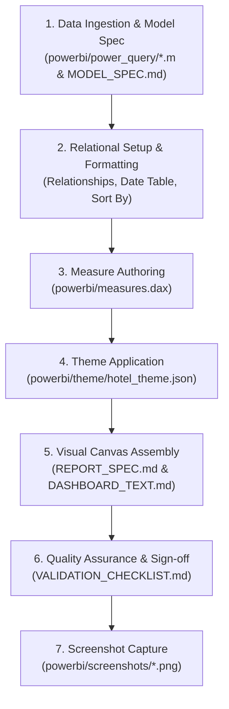

# Hotel Revenue & Occupancy Analytics: Power BI Asset Repository

This directory contains the complete star schema data model, Power Query M scripts, DAX measure suite, theme styling, visual layout specifications, and build guides for the enterprise Power BI reporting dashboard (`hotel_revenue_analytics.pbix`).

---

## 1. Executive Model Summary

The data model is an enterprise star schema engineered to reconcile two distinct analytical grains: reservation transaction cohorts (`fact_bookings`, 119,388 rows, evaluated on guest arrival date) and realized stay operations (`fact_stay_nights`, 248,261 rows, evaluated on individual stay date), paired with property capacity (`fact_capacity`, 1,524 rows). Three shared conforming dimensions—`dim_date` (1,096 calendar days), `dim_hotel` (2 properties: City Hotel and Resort Hotel), and `dim_profile` (28 guest profile combinations across market segments and distribution channels)—connect through 8 active, single-directional, one-to-many (`1:*`) relationships. The architecture strictly enforces Rule K7 (capacity and available rooms remain property-level metrics unaffected by profile cross-filtering, ensuring segment occupancy reflects true portfolio contribution) and Rules W1/W2 (restricting stay revenue and occupancy analysis strictly to the 25-month reliable performance window from August 1, 2015 to August 31, 2017).

---

## 2. File Catalog

| File / Folder | Purpose & Contents | Primary Consumers |
| :--- | :--- | :--- |
| [`powerbi/data/`](file:///Users/divyansh/code/Development/DataScience/hotel-revenue-analytics/powerbi/data/) | Six exported star schema CSV tables (`dim_date`, `dim_hotel`, `dim_profile`, `fact_bookings`, `fact_stay_nights`, `fact_capacity`). UTF-8 encoded, ISO dates, numeric flags (`0`/`1`), no null strings. | Power Query M Ingestion |
| [`powerbi/power_query/`](file:///Users/divyansh/code/Development/DataScience/hotel-revenue-analytics/powerbi/power_query/) | Pure M ETL scripts for Power BI Desktop. Contains `parameters.m` (defines the dynamic `DataFolder` file path parameter) and 6 query definitions enforcing explicit column typing with locale `en-US`. | Advanced Editor in Power Query |
| [`powerbi/MODEL_SPEC.md`](file:///Users/divyansh/code/Development/DataScience/hotel-revenue-analytics/powerbi/MODEL_SPEC.md) | Exhaustive data model blueprint: 48 column definitions, storage types, default summarizations (`Don't summarize`), column hiding rules, date table marking, sort-by column pairs, and relationship topology. | Power BI Model View |
| [`powerbi/measures.dax`](file:///Users/divyansh/code/Development/DataScience/hotel-revenue-analytics/powerbi/measures.dax) | 26 production-ready DAX measures organized across 4 display folders (`Bookings`, `Stay-night KPIs`, `Shares and trends`, `Assumptions`). Includes comments, format strings, and business rules. | Power BI Report View / Measures Table |
| [`powerbi/REPORT_SPEC.md`](file:///Users/divyansh/code/Development/DataScience/hotel-revenue-analytics/powerbi/REPORT_SPEC.md) | Pixel-precise visual specification (1280x720 canvas) for 4 core analytical pages and 2 supporting pages. Details visual types, coordinates ($x, y, w, h$), field bindings, sort orders, and interactions. | Power BI Visual Canvas Assembly |
| [`powerbi/theme/hotel_theme.json`](file:///Users/divyansh/code/Development/DataScience/hotel-revenue-analytics/powerbi/theme/hotel_theme.json) | Custom JSON theme: 8 color-blind-safe corporate palette colors (WCAG contrast compliant $\ge 3:1$ against white, $\ge 7:1$ foreground), Segoe UI typography, and card/chart styling. | View Tab $\rightarrow$ Browse for Themes |
| [`powerbi/DASHBOARD_TEXT.md`](file:///Users/divyansh/code/Development/DataScience/hotel-revenue-analytics/powerbi/DASHBOARD_TEXT.md) | Dynamically computed narrative copy, card subtitles, visual titles, accessibility alt text, and 6 key business findings with underlying CSV source citations. | Card Callouts & Text Visuals |
| [`powerbi/BUILD_GUIDE.md`](file:///Users/divyansh/code/Development/DataScience/hotel-revenue-analytics/powerbi/BUILD_GUIDE.md) | Numbered, step-by-step assembly manual for Power BI Desktop (Windows). Details estimated completion times, click sequences, visual checkpoints, and troubleshooting protocols. | Report Author Manual Assembly |
| [`powerbi/validation_expected.csv`](file:///Users/divyansh/code/Development/DataScience/hotel-revenue-analytics/powerbi/validation_expected.csv) | 138 benchmark expected values generated by pandas directly from star schema CSVs across 6 slicer scenarios (S1–S6) and all 23 numeric measures. | Verification & Automated Testing |
| [`powerbi/VALIDATION_CHECKLIST.md`](file:///Users/divyansh/code/Development/DataScience/hotel-revenue-analytics/powerbi/VALIDATION_CHECKLIST.md) | Quality assurance checklist for human sign-off covering 6 scenarios across 10 critical measures with exact slicer setup instructions and tolerance thresholds. | Pre-flight Sign-off Review |
| [`powerbi/screenshots/`](file:///Users/divyansh/code/Development/DataScience/hotel-revenue-analytics/powerbi/screenshots/) | Target directory for report visual artifacts, full-page PNG captures, and model diagram screenshots. | Documentation & Sign-off |

---

## 3. Recommended Order of Use

To assemble and sign off on the Power BI dashboard from scratch, follow this exact workflow:



1. **Configure Parameters & Import Tables**: Open Power BI Desktop, launch Power Query Advanced Editor, create parameter `DataFolder` using [`powerbi/power_query/parameters.m`](file:///Users/divyansh/code/Development/DataScience/hotel-revenue-analytics/powerbi/power_query/parameters.m), and import the 6 queries ([`BUILD_GUIDE.md` Section 1](file:///Users/divyansh/code/Development/DataScience/hotel-revenue-analytics/powerbi/BUILD_GUIDE.md#1-create-datafolder-parameter--load-queries-15-minutes)).
2. **Establish Model Relationships**: Switch to Model View, establish the 8 active `1:*` relationships, mark `dim_date` as a Date Table, set sort-by columns, and hide surrogate keys ([`MODEL_SPEC.md`](file:///Users/divyansh/code/Development/DataScience/hotel-revenue-analytics/powerbi/MODEL_SPEC.md) & [`BUILD_GUIDE.md` Section 2](file:///Users/divyansh/code/Development/DataScience/hotel-revenue-analytics/powerbi/BUILD_GUIDE.md#2-model-view-configuration-15-minutes)).
3. **Author DAX Measures**: Create dedicated `Measures` table, add all 26 measures from [`powerbi/measures.dax`](file:///Users/divyansh/code/Development/DataScience/hotel-revenue-analytics/powerbi/measures.dax), assign display folders, and apply format strings ([`BUILD_GUIDE.md` Section 3](file:///Users/divyansh/code/Development/DataScience/hotel-revenue-analytics/powerbi/BUILD_GUIDE.md#3-create-measures-table--dax-measures-25-minutes)).
4. **Apply Report Theme**: Go to **View** $\rightarrow$ **Themes** $\rightarrow$ **Browse for themes**, select [`powerbi/theme/hotel_theme.json`](file:///Users/divyansh/code/Development/DataScience/hotel-revenue-analytics/powerbi/theme/hotel_theme.json).
5. **Assemble Report Canvas**: Build Pages 1 through 6 following pixel coordinates, titles, and alt text from [`powerbi/REPORT_SPEC.md`](file:///Users/divyansh/code/Development/DataScience/hotel-revenue-analytics/powerbi/REPORT_SPEC.md) and [`powerbi/DASHBOARD_TEXT.md`](file:///Users/divyansh/code/Development/DataScience/hotel-revenue-analytics/powerbi/DASHBOARD_TEXT.md).
6. **Execute Verification Checklist**: Test slicer scenarios S1 through S6, compare canvas cards against [`powerbi/validation_expected.csv`](file:///Users/divyansh/code/Development/DataScience/hotel-revenue-analytics/powerbi/validation_expected.csv), and record results in [`powerbi/VALIDATION_CHECKLIST.md`](file:///Users/divyansh/code/Development/DataScience/hotel-revenue-analytics/powerbi/VALIDATION_CHECKLIST.md).
7. **Capture Report Screenshots**: Capture high-resolution PNG screenshots of each page and save to [`powerbi/screenshots/`](file:///Users/divyansh/code/Development/DataScience/hotel-revenue-analytics/powerbi/screenshots/).

---

## 4. How to Refresh Data

When backend PostgreSQL data changes or when new booking records are ingested:

1. **Re-export Star Schema CSVs**:
   From the repository root, run:
   ```bash
   ./.venv/bin/python src/export_powerbi_model.py
   ```
   This script regenerates the 6 CSV files in `powerbi/data/` directly from schema `hotel` in PostgreSQL.
2. **Re-validate Schema Integrity**:
   Run the model validation pre-flight test:
   ```bash
   ./.venv/bin/python src/validate_powerbi_model.py
   ```
   Ensure all 16 integrity and reconciliation checks report `[PASS]`.
3. **Refresh Power BI Desktop**:
   - Open `hotel_revenue_analytics.pbix` in Power BI Desktop.
   - On the **Home** ribbon tab, click **Refresh** (or press `F5`).
   - Power Query re-reads the updated CSVs from the path specified in `DataFolder`.
   - All DAX measures, visuals, drillthrough pages, and slicers update automatically without modifying report layout.

---

## 5. Required Screenshot Inventory

Once the `.pbix` report is assembled, take high-resolution screenshots (1280x720 or higher) for each page and save them in [`powerbi/screenshots/`](file:///Users/divyansh/code/Development/DataScience/hotel-revenue-analytics/powerbi/screenshots/):

1. `powerbi/screenshots/page1_executive.png`:
   - Page 1: Executive Overview (KPI cards, RevPAR trend by hotel, revenue & ADR combo chart, cancellation distribution donut).
2. `powerbi/screenshots/page2_revenue.png`:
   - Page 2: Revenue & Occupancy Dynamics (Monthly occupancy heatmaps, market segment matrix, direct vs OTA ADR scatter plot).
3. `powerbi/screenshots/page3_cancellations.png`:
   - Page 3: Cancellation & Risk Intelligence (Lead time cancel rate curve, deposit type risk bars, customer type breakdown, ADR vs cancel matrix).
4. `powerbi/screenshots/page4_insights.png`:
   - Page 4: Strategic Insights & Decisions (Key findings callouts, overbooking buffer recommendations, room mismatch analysis).
5. `powerbi/screenshots/page5_drillthrough.png`:
   - Page 5: Booking Cohort Drillthrough (Segment/channel transaction detail table with conditional formatting).
6. `powerbi/screenshots/page6_model.png`:
   - Model View: Full entity relationship diagram showing `dim_date`, `dim_hotel`, and `dim_profile` connected to `fact_bookings`, `fact_stay_nights`, and `fact_capacity`.
